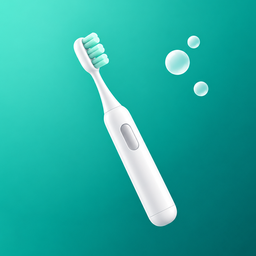

# FreeBrush

An open-source Android app for Oclean smart toothbrushes that works offline.
It talks to the brush directly over Bluetooth Low Energy. You need no account and no cloud, and your
brushing data never leaves the phone. The only time the app goes online is a daily check for its own
updates on GitHub, which you can turn off.

> **Status: early alpha.** Syncing works on a real **Oclean X Pro Digital** (`OCLEANY3PB`,
> firmware 1.0.2.5). Other models that share the same Bluetooth protocol may work, but nobody has
> tested them yet. See [Supported brushes](#supported-brushes).

[По-русски](#по-русски)

## Why

The official app makes you create an account before it does anything. It shows a server-driven
splash banner and sends your brushing data and usage statistics to the vendor's servers. All the
useful data (score, duration, per-zone time, pressure) is measured by the brush itself, so none of
that is needed. FreeBrush reads the data straight from the brush and keeps it on your phone.

## Features

| | FreeBrush | Official app |
|---|---|---|
| Brushing history: score, duration, zones, pressure¹ | ✅ on the phone | ✅ in the cloud |
| Brush-head counters (days, sessions, wear) | ✅ | ✅ |
| Works without an account | ✅ | ❌ |
| Internet access | only the update check, can be turned off | required |
| Ads / splash banners | none | server-driven banner |
| Streaks, two-week chart, daily goal | ✅ | partly |
| 3D jaw model you can rotate and tap for per-zone stats | ✅ | flat diagram |
| Several people's brushes on one phone, each with its own name, history and level | ✅ | family accounts in the cloud |
| Export to CSV | ✅ | ❌ |
| Brush settings: zone reminder, raise-to-wake, day/evening mode, side-motion warning, display language, brush-head reset and limit | ✅ | ✅ |
| Settings the official app hides on this brush: pressure alert, brush pause, wake-up mode | ✅ | ❌ |
| Growth level on the brush screen actually grows with brushing | ✅ | ❌ stays at level 1 |
| Brushing programmes: the brush's built-in modes (incl. the hidden day/evening ones), Oclean's catalogue | ✅ | ✅ |
| Custom programmes | ✅ up to 25, up to 9 steps, 32 cleaning levels + whitening, massage, sensitive, 5–255 s steps | 3 programmes, 6 steps, 4 levels per mode |
| Firmware updates | ❌ never: firmware comes from the vendor's servers | ✅ |
| Family accounts, "expert" reports, AI chat | ❌ | ✅ |

¹ Only on brushes that log pressure. The X Pro Digital sends a fixed placeholder instead, so FreeBrush hides it.

The brush keeps its last 32 sessions and overwrites the oldest ones. FreeBrush does not delete sessions from the
brush, so sync at least every couple of weeks to keep the full history.

## Supported brushes

| Model | Model ID | Status |
|---|---|---|
| Oclean X Pro Digital | `OCLEANY3PB` | ✅ sync confirmed (firmware 1.0.2.5): score, duration, zones, battery, brush-head counters |
| Oclean X Pro Elite | `OCLEANY3P`, `OCLEANY3X` | same protocol, untested |
| Oclean X / X Pro / X Pro 20 / X Ultra | `OCLEANY3M`, `OCLEANY3`, `OCLEANX20`, `OCLEANV1a` | same protocol family, untested |

If you own another Oclean model, open a [device report](../../issues/new?template=device-report.yml)
with the sync log from the **Brush** tab.

## Install

Download `FreeBrush-<version>.apk` from [Releases](../../releases/latest) and open it on the phone,
or build it yourself. Requires Android 12 or newer and Bluetooth LE.

FreeBrush updates itself: once a day it asks GitHub for the latest release and offers it in a dialog.
The first update asks you to allow installs from FreeBrush; after that Android installs updates without
another prompt. Turn the check off under **Brush → Updates**, or check by hand there.

**Close the official Oclean app before syncing.** The brush accepts only one connection at a time.
The official app also appears to clear the brush's session buffer when it syncs, so sessions that
it picks up first will not reach FreeBrush.

## Build

JDK 17+ and the Android SDK (compile SDK 37) are needed.

```bash
./gradlew assembleDebug
./gradlew testDebugUnitTest
```

The APK lands in `build/outputs/apk/debug/`.

### Releases

The version lives in `version.properties`. Raising it on `main`, together with a `## [X.Y.Z]` section in
`CHANGELOG.md`, is the whole release: the [Release](.github/workflows/release.yml) workflow tags `vX.Y.Z`,
builds the APK signed with the release key from the repository secrets and publishes it with its SHA-256.
Builds between releases are named `X.Y.Z-dev+<commit>`.

## Privacy

- Bluetooth permissions: `BLUETOOTH_SCAN` (flagged `neverForLocation`) and `BLUETOOTH_CONNECT`.
- Update permissions: `INTERNET` for the update check and download, `REQUEST_INSTALL_PACKAGES` and
  `UPDATE_PACKAGES_WITHOUT_USER_ACTION` to install the update. The check is one request to
  `api.github.com` for this repository's latest release; GitHub sees your IP address and the app and
  Android versions in the User-Agent, nothing else is sent. The APK comes from GitHub's release downloads,
  must match the SHA-256 published with it and be signed with the same key as the installed app.
  With the check turned off, the app makes no network requests at all.
- No cloud backup: Android's backup to Google Drive excludes the app's data. Moving to a new phone with
  Android's device transfer still brings the history and brushes along.
- Bluetooth packets are written to the system log only in debug builds.
- Brushing history is stored in the app's private storage (`sessions.json`) and leaves the phone
  only when you export it yourself.
- No analytics, no crash reporting, no third-party SDKs besides AndroidX and Jetpack Compose.

## How it works

The brush exposes a vendor GATT service. FreeBrush connects, reads the Device Information and Battery
services, subscribes to the brush's notification characteristics and asks for stored sessions. It then
decodes the session records and merges them into the local history, de-duplicating by session start time.
The protocol notes this app relies on come from the community projects listed below, checked for
interoperability against the behaviour of the official app.

## Credits

- [ha-oclean-integration](https://github.com/deniskie/ha-oclean-integration) by Denis Kiesel (MIT):
  the Home Assistant integration whose protocol reference made this app possible.
  See [THIRD_PARTY_NOTICES.md](THIRD_PARTY_NOTICES.md).
- [esphome-oclean](https://github.com/dzikus/esphome-oclean) (GPL-3.0): ESPHome component for
  Oclean brushes.

## Disclaimer

FreeBrush is an independent project. It is not affiliated with, endorsed by or connected to Oclean or
its parent company. "Oclean" is a trademark of its respective owner and is used here only to say
which devices the app works with. Use the app at your own risk. It never writes firmware to the brush.

## License

[GPL-3.0-or-later](LICENSE).

---

## По-русски

FreeBrush — открытое Android-приложение для умных щёток Oclean. Оно работает без аккаунта и облака:
забирает данные со щётки по Bluetooth и хранит их только на телефоне. В интернет приложение ходит только
за своими обновлениями: раз в день спрашивает GitHub, нет ли новой версии. Это выключается в
**Щётка → Обновления**.

**Статус: ранняя альфа.** Синхронизация проверена на реальной **Oclean X Pro Digital** (`OCLEANY3PB`,
прошивка 1.0.2.5). Другие модели с тем же протоколом могут работать, но не проверены.

Щётка хранит последние 32 чистки и затирает самые старые. FreeBrush ничего со щётки не удаляет, поэтому
синхронизируйся хотя бы раз в пару недель, чтобы история была полной.

**Что умеет:**
- История чисток: оценка, длительность, время по зонам, нажим.
- Серия дней подряд, график за две недели, цель — две чистки в день.
- Экспорт истории в CSV.

- Настройки щётки, включая скрытые в официальном приложении: оповещение о нажиме, язык экрана,
  счётчик насадки; встроенные режимы, каталог программ Oclean и свои программы до 9 шагов.
- Уровень роста на экране щётки растёт по настоящим чисткам.
- Несколько щёток на одном телефоне, по одной на человека: у каждой своё имя, история, статистика и уровень,
  переключаются чипами сверху. «Заменить на новую щётку» переносит историю и уровень человека на его новую щётку.
- Обновляется сама: APK берётся из [релизов](../../releases/latest) на GitHub.

**Чего не будет:** обновления прошивки (файлы лежат на серверах Oclean), семейные аккаунты, «экспертные»
отчёты, AI-чат.

**Перед синхронизацией закрой официальное приложение Oclean.** Щётка держит только одно соединение,
а официальное приложение, судя по всему, стирает с неё историю чисток при своей синхронизации.

Проект не связан с компанией Oclean. «Oclean» — товарный знак его владельца. Лицензия — GPL-3.0-or-later.
